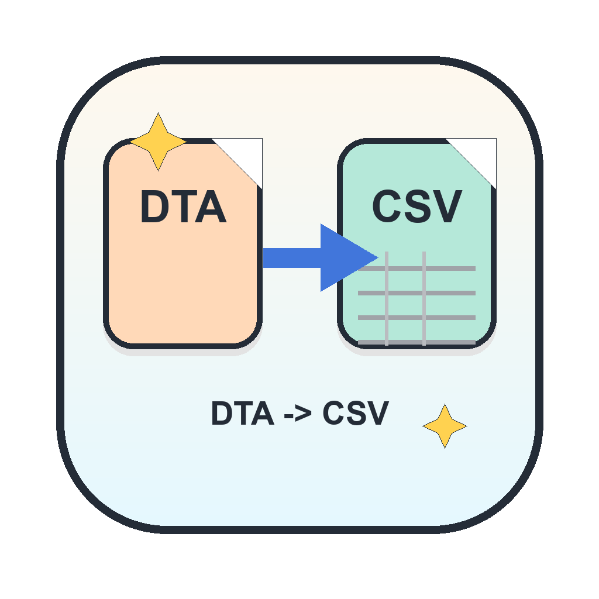

# DTA -> CSV

Drag-and-drop macOS app for converting Stata `.dta` files to `.csv`.



## Download

Download the Apple Silicon build from:

https://github.com/sunfhs/dta-to-csv-mac/releases/latest/download/DTA-to-CSV-AppleSilicon.zip

Unzip it, open `DTA -> CSV.app`, then drag `.dta` files or folders into the window. CSV files are written next to the original files. If you drop a folder, output goes into a sibling folder ending in `_CSV`.

## macOS Security

This app is locally signed but not Apple-notarized. On first open, macOS may show a warning.

Use this flow:

1. Click `Done`. Do not move the app to Trash.
2. Open `System Settings`.
3. Go to `Privacy & Security`.
4. Scroll to `Security`.
5. Click `Open Anyway`.
6. Open the app again.

Full notarization is skipped for now because it requires an Apple Developer account. Add it when the app needs a no-warning first launch for broad public distribution.

## Source Checks

```bash
python3 -m venv --system-site-packages .venv
source .venv/bin/activate
pip install -r requirements.txt
python3 self_check.py
python3 progress_check.py
```

## Build

```bash
source .venv/bin/activate
./build_release.sh
```

The release zip is created at `dist/DTA-to-CSV-AppleSilicon.zip`.
